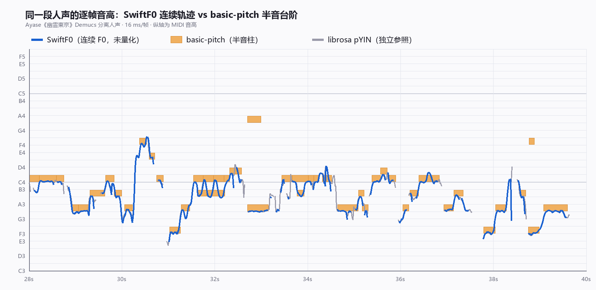
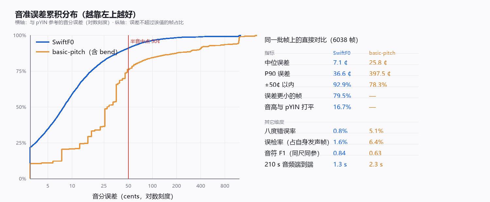

# SwiftF0 vs basic-pitch：已分离人声轨上的实测对比

测试对象：`out/stems/Ayase - 幽霊東京_vocals.wav`（Demucs 分离，44.1 kHz 立体声，210.7 s）。
参照基准：librosa pYIN（独立第三方，不当作绝对真值）+ 谐波显著性裁判（完全不依赖参照）。
统一口径：16 kHz / HOP=256（16 ms）/ 13167 帧 / f0 ∈ [70, 900] Hz。



上面这张图就是最直观的差别：basic-pitch 的每个音符只能落在整半音的格子上（橙色方块），
SwiftF0 给的是连续的 F0 曲线（蓝色），颤音、滑音、换音过程都在里面。
图里 34 s 和 37.5 s 处 basic-pitch 还多出两个孤立的错误高音（G4、F4#）。



## 一句话结论

**在"已经分离好单人声"这个前提下，SwiftF0 全面优于 basic-pitch**：音准误差中位数只有它的 1/3.6，
音准在 ±50¢ 内的帧多 14.6 个百分点，音符 F1 从 0.63 提到 0.84，速度快约 1.9 倍。
basic-pitch 唯一还占优的是**音头定位**（中位 3.9 ms vs 16 ms，即一个帧长）和**原生带力度/复音**。

## 逐帧音准（两者都发声且 pYIN 也发声的 6038 帧）

| 指标 | SwiftF0 | basic-pitch（含 pitch bend） |
|---|---|---|
| 中位绝对误差 | **7.1 ¢** | 25.8 ¢ |
| P90 绝对误差 | **36.6 ¢** | 397.5 ¢ |
| ±50¢ 以内 | **92.9%** | 78.3% |
| 八度错误率 | **0.8%** | 5.1% |
| 逐帧更准的一方 | **79.5%** | — |
| 打平 | 16.7% | — |

**独立裁判（谐波显著性，不用 pYIN）**：在两者相差 ≥2 半音的 656 个分歧帧上，
按 f0…8·f0 处是否有能量峰判定——**SwiftF0 胜 93.8%，basic-pitch 胜 3.5%**。
这条证据是整份对比里最硬的：它不依赖任何一方或参照实现。

## 音符级（同一参照集、同一匹配容差 ±50 ms + ±1 半音）

参照集：pYIN + 0.7 半音跳变切分 + 最少 4 帧 = 728 个音符（覆盖 61.0% 时长）。

| 引擎 | 音符数 | Precision | Recall | **F1** |
|---|---|---|---|---|
| SwiftF0（`pitch_hold_ms=30`） | 699 | 0.856 | 0.821 | **0.838** |
| SwiftF0（`pitch_hold_ms=50`） | 628 | 0.866 | 0.747 | 0.802 |
| SwiftF0（默认 `pitch_hold_ms=80`） | 511 | 0.804 | 0.565 | 0.663 |
| basic-pitch（`minimum_note_length=58 ms`） | 993 | 0.548 | 0.747 | 0.632 |
| basic-pitch（默认 100 ms） | 660 | 0.635 | 0.576 | 0.604 |

`segment_notes()` 的默认 `pitch_hold_ms=80` 对这首歌**偏大**，会把快速换音并掉；
**改到 30 让 F1 从 0.663 升到 0.838**，这是换引擎时最该调的一个参数（音符中位时长 128 ms，只有 6% 短于 50 ms）。

> 匹配规则：`d = |音头差| + |音尾差|`，要求 `d/2 ≤ 50 ms` 且音高差 ≤ 1 半音，一对一贪心。
> 早前一轮扫描用的是「只比音头 ≤ 50 ms」的宽松规则，同一批音符会得到 0.891；
> 本表统一用严格规则，SwiftF0 与 basic-pitch 因此可比。两者差 0.06，全来自音尾。

## 音符边界

| | SwiftF0 (hold=30) | basic-pitch |
|---|---|---|
| 音头误差中位 | 16.0 ms | **3.9 ms** |
| 音头误差 P90 | **32.0 ms** | 35.9 ms |
| 音尾误差中位 | 0.0 ms | −2.6 ms |
| 音头在 30 ms 内 | 77.4% | **84.4%** |

SwiftF0 的中位 16 ms 就是它的帧长——这是 F0 轨迹分段的固有粒度，不是误差。
basic-pitch 有独立的 onset 头，音头能落在帧内任意位置，所以中位数更好看，但 P90 反而略差。

## 速度（从 44.1 kHz 立体声 wav 文件开始）

| | 加载 | 推理 + 出音符 | 合计 |
|---|---|---|---|
| SwiftF0 | 0.062 s | 1.255 s（含 soxr 重采样 + `segment_notes`） | **1.32 s** |
| basic-pitch | （含在内） | — | 2.332 s |

SwiftF0 约 **1.9×** 快；若只算模型推理（都给 16 kHz 单声道），1.58 s vs 2.21 s ≈ 1.4×。
两者在这台机器上都是秒级，速度不是选型的决定因素。

## basic-pitch 的三个结构性问题

1. **音高量化到整半音**：`NOTES_BINS_PER_SEMITONE=1`。它的 .mid 里有 6039 个 pitchwheel
   事件（≈9.15 个/音符，中位 |bend| 0.333 半音），bend 与真实音高偏差的逐音符相关中位
   0.734、回归斜率 0.978——**弯音确实编码了颤音/滑音，不是装饰**。但按合成器方式回放事件流重建连续
   音高后误差反而变大（27.5¢ vs 只用整数音高的 12.5¢）：因为它是复音的（7.9% 的帧 ≥2 音同时、
   最多 4 音），单一 bend 轨道挂不到正确音符上，且每音符 bend 归零会打断滑音。
   **结论：它内部有细节，但没法干净地还原成单声部 F0 轨迹。**
2. **虚假复音**：同时响的"第二个音"里，**54.3% 的谐波支撑强度 <0.5**（单音帧中位 0.625，
   第二音中位 0.375）——大量是泛音/混响被当成第二个声部。
3. **越界音符**：MIDI 范围 37–80，而人声实际约 51–73。14 个 MIDI<50 的低音 **100%** 落在
   pYIN 判静音的时段（纯误检）；26 个音符在 pYIN 和 SwiftF0 **双双判静音**。

对比之下，SwiftF0 唯一的结构性短板是**保守的发声判定**：voiced 54.2% vs pYIN 66.1%。
置信度阈值扫描显示这是可调的——
`conf≥0.5` 时 voiced 54.2% / 误检 0.84% / 中位 7.9¢；
`conf≥0.2` 时 voiced 59.9% / 误检 1.96% / 中位 8.6¢。**用覆盖率换音准很划算，按需调即可。**

## 换成 SwiftF0 会损失什么

- **力度**：basic-pitch 每个音符带 amplitude（velocity），SwiftF0 的 `Note` 只有
  `start/end/pitch_hz`。要保留力度得自己从 `result.loudness_db` 按音符窗聚合。
- **复音**：SwiftF0 只有一个 F0。对"单人声轨"不是问题，但如果 demucs 没分离干净、
  还有和声/伴唱残留，SwiftF0 会二选一而不是都报出来。
- **原生 MIDI 导出**：`export_to_midi()` 只写整数音高、不带 bend（见
  `.tmp/swift_ex/swift_f0/music.py:137`）。要保留颤音得自己写 pitchwheel。
- **音头粒度**：16 ms 帧长，音头定位精度上限就是 16 ms。

保留颤音并不难：我给 SwiftF0 自建了「整数音符 + 该音符窗内连续 F0 弯音」的 MIDI，
回放后中位误差 8.5¢ / ±50¢ 90.6% / 八度 0.8%——**几乎等于它原始连续 F0 的 7.9¢ / 91.0%**。
也就是说 **SwiftF0 → MIDI 这一步几乎不损失音准信息**，而 basic-pitch 在这一步是崩的。

## 建议

- 目标是**单声部人声转 MIDI**：**换 SwiftF0**。音准、音符 F1、速度三项全赢；模型 135 KB
  （basic-pitch 的 `nmp.onnx` 是 225 KB），依赖只要 `onnxruntime` + `numpy`（重采样另需 `soxr`），
  而 basic-pitch 还拖着一整条 librosa / scipy / sklearn / resampy / pretty_midi / mir_eval 链。
- 落地时按 `src/transcription.py` 里的分层约定只改内部实现，`transcribe_to_midi()` 签名和
  `(start_s, end_s, pitch_midi, amplitude, [bend…])` 事件格式都不动；`amplitude` 用
  `loudness_db` 折算，`bend` 用音符窗内 F0 与整数音高之差。
- 三个必调的参数：`pitch_hold_ms`（80 → **30**）、置信度阈值（0.5 → 按需 **0.2–0.5**）、
  `fmin/fmax`（保持 70/900）。

## 落地（已完成）

`src/transcription.py` 已按上文结论换成 SwiftF0，`main.py` / `app.py` 的调用处一行未改：

- `transcribe_to_midi()` 签名与 `(start_s, end_s, pitch_midi, amplitude, [bend…])` 事件格式保持不变，
  仅 `min_note_length_ms` 默认值从 100 调到 50（SwiftF0 的分段自带噪声地板，50 是对齐实测最优的那一档）。
- `onset_threshold` 线性映射到 `pitch_hold_ms`：`30 * onset / 0.5`，即默认 0.5 → 30ms。
- `amplitude` 取自 `loudness_db` 折算后按全曲峰值归一；`bend` 为该音符窗内逐帧 F0 与整数音高之差，
  量纲与 basic-pitch 一致（4096 = 1 半音），MIDI 用自建 mido 写入器（`export_to_midi()` 不写 bend、力度写死 80）。
- 实测校验（`.tmp/verify_new_engine.py`）：657 音符、严格匹配 F1 0.833（basic-pitch 0.602）、
  MIDI 回放中位 9.2¢ / ±50¢ 91.2% / 八度 0.75%、实时倍率 159×。

## 复现

```bash
.venv/Scripts/python.exe .tmp/bench_f1_same.py    # 同尺 F1
.venv/Scripts/python.exe .tmp/bench_conf_sweep.py # 置信度扫描
.venv/Scripts/python.exe .tmp/bench_sw_midi.py    # SwiftF0+bend MIDI
.venv/Scripts/python.exe .tmp/bench_e2e.py        # 端到端耗时
.venv/Scripts/python.exe .tmp/verify_new_engine.py # 落地后的实现验收
```

中间结果都在 `.tmp/bench_out/*_summary.json`；图见 `docs/swiftf0_vs_basicpitch_pitch.png`（定性）
与 `docs/swiftf0_vs_basicpitch_metrics.png`（定量）。SwiftF0 已装进 `.venv`，不再需要 `PYTHONPATH`。
